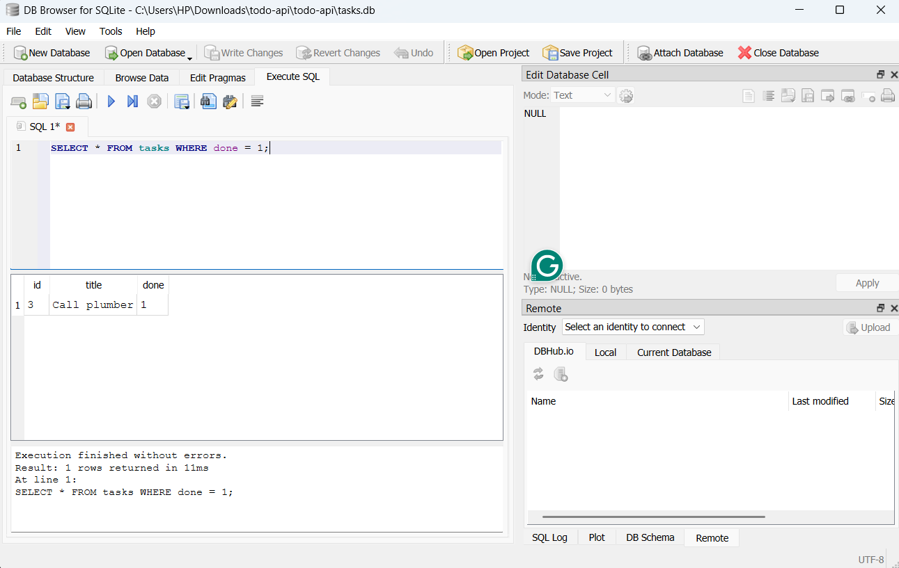

# Task API (SQLite edition)

A CRUD API for managing a to-do list, built with **FastAPI**. Assignment 1 kept its
tasks in memory (gone on every restart); this version stores them in a real
**SQLite** database instead. The endpoints, request/response shapes, and status
codes are unchanged from Assignment 1 — only the storage layer moved.

## Why SQLite

- Zero setup: no separate database server to install, configure, or run.
- The whole database is one file (`tasks.db`), which is perfect for a small
  project like this and for learning SQL without extra moving parts.
- It's created automatically the first time the app runs, and it's easy to
  inspect by hand with a free GUI tool (see Stage 4 below).

## Where the database lives

`tasks.db`, created automatically in the project folder the first time the
app starts. It's listed in `.gitignore`, so every fresh clone starts with a
clean database (the `tasks` table and 3 example tasks are recreated on first
run — see `db.py`).

## Install & run

```bash
pip install -r requirements.txt
uvicorn main:app --reload --port 8000
```

Then open **http://localhost:8000** in your browser, or **http://localhost:8000/docs**
for the interactive Swagger UI. On first run, `tasks.db` is created automatically
with the `tasks` table and 3 seed tasks.

## Endpoints

| Method | Path            | Description                              | Success | Errors |
|--------|-----------------|-------------------------------------------|---------|--------|
| GET    | `/`             | API description                           | 200     | —      |
| GET    | `/health`       | Liveness check                            | 200     | —      |
| GET    | `/tasks`        | List all tasks (supports filters below)   | 200     | —      |
| GET    | `/tasks/{id}`   | Get one task                              | 200     | 404    |
| POST   | `/tasks`        | Create a task (`{"title": "..."}`)        | 201     | 400    |
| PUT    | `/tasks/{id}`   | Update a task's `title` and/or `done`     | 200     | 400, 404 |
| DELETE | `/tasks/{id}`   | Delete a task                             | 204     | 404    |
| GET    | `/stats`        | *(extra)* `{ total, done, open }` counts, computed with SQL `COUNT()` | 200 | — |
| POST   | `/reset`        | *(extra)* Wipe and restore the 3 seed tasks | 200   | —      |

`GET /tasks` also accepts optional query parameters (now implemented as SQL
`WHERE`/`LIKE`/`LIMIT` clauses instead of Python list filtering):

- `?done=true` / `?done=false` — filter by completion status
- `?search=milk` — only tasks whose title contains the text (`LIKE` operator)
- `?limit=2&offset=2` — pagination

Every error response is shaped as `{ "error": "..." }`.

## Persistence check

```bash
curl -s -X POST http://localhost:8000/tasks -d '{"title":"Buy milk"}' -H "Content-Type: application/json"
# stop the server (Ctrl+C), then start it again
uvicorn main:app --port 8000
curl -s http://localhost:8000/tasks
# "Buy milk" is still there
```

## Exploring the database by hand (Stage 4)

Opened `tasks.db` in **DB Browser for SQLite** and ran, in the "Execute SQL" tab:

```sql
SELECT * FROM tasks WHERE done = 1;
```

This returned the one seeded task marked complete (`Call plumber`). Changing
rows here and then calling `GET /tasks` immediately reflects the edit — the
API and DB Browser read the same file, so there's nothing to "sync."

> **Add your screenshot here:** open `tasks.db` in DB Browser for SQLite,
> run a query, and paste a screenshot into this section before you submit.



## What changed vs. Assignment 1

- Storage moved from a Python list to a `tasks` table in `tasks.db`.
- Every CRUD operation now runs a parameterized SQL query (`?` placeholders —
  never string-glued SQL) via `db.py`.
- The table is created automatically if missing, and seeded with 3 example
  tasks only the first time (checked with `SELECT COUNT(*)` before inserting).
- The API's routes, request/response bodies, and status codes are identical —
  proving that storage really is just an implementation detail behind the API.

## Project structure

```
.
├── main.py           # the API (routes, validation, same shapes as A1)
├── db.py             # SQLite connection, schema creation, seeding
├── requirements.txt
└── README.md
```
