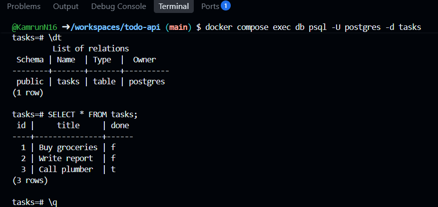

# Task API

A RESTful Task Management API built with FastAPI and PostgreSQL. The application and database are containerized using Docker Compose, with persistent database storage.

## Technologies Used

- Python 3.12
- FastAPI
- PostgreSQL 17
- Psycopg
- Docker
- Docker Compose

## Project Features

- Create, retrieve, update, and delete tasks.
- Store task data in PostgreSQL.
- Automatically create the tasks table if it does not exist.
- Seed three initial tasks when the database is empty.
- Validate task titles.
- Return appropriate HTTP status codes.
- Persist database records using a Docker named volume.

## Environment Variables

Create a `.env` file in the project root using `.env.example` as a template.

Required variables:

- `POSTGRES_USER`
- `POSTGRES_PASSWORD`
- `POSTGRES_DB`
- `DATABASE_URL`

The API connects to PostgreSQL using the hostname `db` inside Docker Compose.

Do not commit your actual `.env` file to GitHub.

## Run the Application

Make sure Docker and Docker Compose are installed.

Run the application using:

    docker compose up --build

API URL: http://localhost:8000

Interactive documentation: http://localhost:8000/docs

## API Endpoints

| Method | Endpoint | Description |
|---|---|---|
| GET | `/` | API information |
| GET | `/health` | Health check |
| GET | `/tasks` | Retrieve all tasks |
| GET | `/tasks/{task_id}` | Retrieve a task |
| POST | `/tasks` | Create a task |
| PUT | `/tasks/{task_id}` | Update a task |
| DELETE | `/tasks/{task_id}` | Delete a task |
| GET | `/stats` | Task statistics |

## Example Requests

Retrieve all tasks:

    curl -i http://localhost:8000/tasks

Retrieve one task:

    curl -i http://localhost:8000/tasks/1

Create a task:

    curl -i -X POST http://localhost:8000/tasks \
      -H "Content-Type: application/json" \
      -d '{"title":"Complete Docker assignment"}'

Update a task:

    curl -i -X PUT http://localhost:8000/tasks/1 \
      -H "Content-Type: application/json" \
      -d '{"title":"Updated task","done":true}'

Delete a task:

    curl -i -X DELETE http://localhost:8000/tasks/1

## Database Persistence

PostgreSQL data is stored in the named Docker volume `taskdata`.

Stop containers:

    docker compose down

Restart the application:

    docker compose up -d

The named volume preserves database records after containers are removed and recreated. Do not use `docker compose down -v` when you want to preserve the data.

## Database Verification

Connect to PostgreSQL:

    docker compose exec db psql -U postgres -d tasks

Verify the table:

    \dt

View stored records:

    SELECT * FROM tasks;

## Database Screenshot

